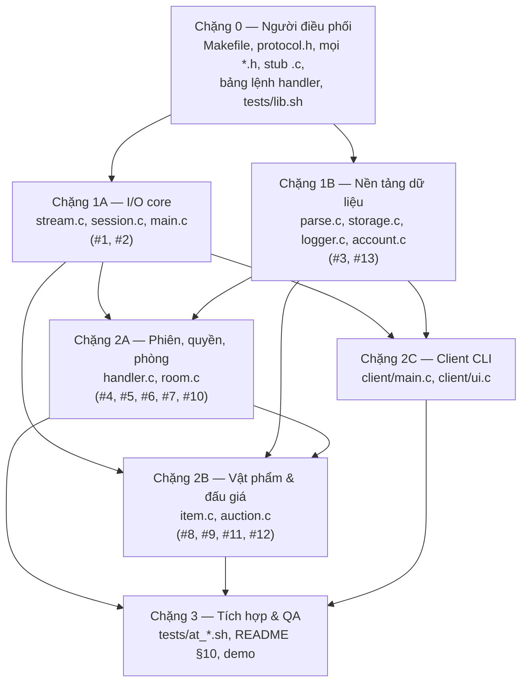

# 01 — Execution Plan & Phân công song song cho AI Agent

> **Mục tiêu:** Biến `docs/specs/` thành các gói việc độc lập để nhiều agent code song song (mỗi agent một nhánh/worktree), không xung đột file, mỗi gói có cổng kiểm tra rõ ràng.

---

## 1. Thứ tự phụ thuộc



`C2A → C2B` chỉ là phụ thuộc **kiểm thử đầu-cuối** (2B cần LOGIN/JOIN của 2A để chạy `nc`); 2B vẫn code song song với 2A dựa trên header đã đóng băng. Thứ tự merge: 2A trước, 2B `git merge dev` rồi chạy lại test.

---

## 2. Ranh giới file (chống xung đột)

**Một agent — một chặng — chỉ sửa đúng file được giao.** File dùng chung chỉ người điều phối sửa, tuần tự: `Makefile`, `.gitignore`, `common/protocol.h`, **mọi `*.h`**, `tests/lib.sh`, `AGENTS.md`, `README.md`, `docs/**`. Agent cần đổi những file này → ghi vào báo cáo, dừng.

| Chặng | Nhánh | File được sửa | Phải đọc | Tiêu chí |
|---|---|---|---|---|
| 0 | `feat/skeleton` | `Makefile`, `.gitignore`, `common/*.h`, `server/*.h`, `client/ui.h`, mọi `.c` dạng stub, `server/handler.c` (chỉ bảng `command_t` + stub), `tests/lib.sh`, `tests/run_all.sh`, `tests/unit/` (khung) | spec 02, 03 | — |
| 1A | `feat/io-core` | `common/stream.c`, `server/session.c`, `server/main.c`, `tests/unit/test_stream.c`, `tests/at_stream.sh` | brief/01–02, spec 01 §1–2, spec 03 §3.1, §4.1, §5 | #1, #2 |
| 1B | `feat/data-layer` | `common/parse.c`, `server/storage.c`, `server/logger.c`, `server/account.c`, `tests/unit/test_parse.c`, `tests/unit/test_account.c` | spec 02 §2, spec 03 §3.2, §4.3, §4.7–4.8, spec 04 | #3, #13 |
| 2A | `feat/session-room` | `server/handler.c` (trừ bảng lệnh), `server/room.c`, `tests/at_session.sh`, `tests/at_room.sh` | spec 01 §4–6, spec 02, spec 03 §4.2, §4.4 | #4, #5, #6, #7, #10 |
| 2B | `feat/item-auction` | `server/item.c`, `server/auction.c`, `tests/at_item.sh`, `tests/at_auction.sh` | spec 01 §7–9, spec 02 §5–6, spec 03 §4.5–4.6, §6, spec 04 §2.3 | #8, #9, #11, #12 |
| 2C | `feat/client` | `client/main.c`, `client/ui.c` | spec 02, spec 05 | (demo) |
| 3 | `feat/integration` | `tests/at_e2e.sh`, `tests/demo.md`; đề xuất sửa README gửi người điều phối | plans/02 | tất cả |

Quy ước git (theo `AGENTS.md`): nhánh tách từ `dev`, commit `feat(<module>): ...`, merge `--no-ff` vào `dev` sau khi người điều phối kiểm lại độc lập; không commit `bin/ data/ logs/ *.o`.

---

## 3. Definition of Done từng chặng

### Chặng 0 — Skeleton (người điều phối)
- [x] `Makefile`: `CFLAGS = -std=c11 -Wall -Wextra -Werror -D_POSIX_C_SOURCE=200809L -g $(CFLAGS_EXTRA)`; đích `all` (tạo `bin/`, `data/`, `logs/`, build `bin/server`, `bin/client`), `clean`, `unit` (build + chạy `tests/unit/*`), `test` (`make clean && make CFLAGS_EXTRA="-DAUCTION_IDLE_SEC=3 -DCOUNTDOWN_INTERVAL_SEC=1" && make unit && bash tests/run_all.sh`), `bin/server_small` (cùng nguồn, thêm `-DMAX_CLIENTS=2`, dùng cho AT-04; `tests/lib.sh` nhận biến `SERVER_BIN`).
- [x] `common/protocol.h` đủ hằng số/enum/tên lệnh/sự kiện của spec 03 §2.
- [x] Mọi header đúng chữ ký spec 03 §3–4 và spec 05 §5.
- [x] Mọi `.c` có stub biên dịch được (hàm lệnh gọi `cmd_reply(s, 500, "Internal error")`; hàm khác trả giá trị trung tính).
- [x] `handler.c` có bảng `command_t` đủ 12 lệnh với `argc` + guard đúng spec 02 §3.
- [x] `tests/lib.sh` có `start_server`, `stop_server`, `client_open`, `client_send`, `expect_line`, `expect_no_line`, `client_close` (plans/02 §1); `tests/run_all.sh` chạy mọi `tests/at_*.sh`, tổng kết PASS/FAIL, mã thoát ≠ 0 nếu có FAIL.
- [x] `make` sạch, không cảnh báo.

### Chặng 1A — I/O core (#1, #2)
- [x] `stream.c` đúng spec 03 §3.1; unit test: nhận thiếu, nhận dính 3 dòng, `\n` không `\r`, dòng = `MAX_LINE`, dòng > `MAX_LINE`, gửi một phần (giả lập bằng socketpair hoặc bộ đệm nhỏ).
- [x] `session.c`: slot tĩnh, `session_send` thêm `\r\n`, broadcast đúng loại trừ, `session_close` là đường đóng duy nhất.
- [x] `main.c` đúng spec 03 §5; non-blocking client fd; `503` khi đầy (test với `-DMAX_CLIENTS=2`).
- [x] AT-01..AT-04 PASS (dùng stub handler: mọi lệnh trả `500`/`400`).

### Chặng 1B — Nền tảng dữ liệu (#3, #13)
- [x] `parse.c` đúng spec 02 §2; unit test ngoặc kép, rỗng `""`, thiếu ngoặc, quá token, số âm/chữ/tràn số.
- [x] `storage.c` ghi qua `.tmp` + `rename`; file không tồn tại = rỗng.
- [x] `logger.c` đúng spec 04 §3.1.
- [x] `account.c`: hash đúng spec 04 §2.1 (unit test: cùng salt+pass → cùng hash; khác salt → khác hash); không lưu mật khẩu rõ.

### Chặng 2A — Phiên, quyền, phòng (#4, #5, #6, #7, #10)
- [x] `handler_process_line` theo ADR-09 bước 1–5; `cmd_reply` gửi + log; kiểm `replied`.
- [x] `REGISTER/LOGIN/LOGOUT` đúng REQ-ACC, REQ-SES.
- [x] `room.c` đúng REQ-ROOM-001..005, `LIST_ROOMS` đúng spec 02 §5.
- [x] AT-05..AT-14 PASS.

### Chặng 2B — Vật phẩm & đấu giá (#8, #9, #11, #12)
- [x] `item.c`, `auction.c` đúng spec 03 §4.5–4.6, §6; lưu `items.txt` sau mỗi thay đổi.
- [x] Thứ tự dòng đúng spec 02 §6 (phản hồi trước `NOTIFY`).
- [x] `auction_resume_all` đúng ADR-10.
- [x] AT-15..AT-27 PASS (build với timer rút ngắn).

### Chặng 2C — Client
- [x] Đúng spec 05; nhận `NOTIFY` trong lúc đang gõ; bảng `ROOMS`/`ITEMS` hiển thị đúng.
- [x] Kiểm tay: kịch bản demo plans/02 §3 chạy được hoàn toàn bằng `bin/client`.

### Chặng 3 — Tích hợp & cổng merge (bắt buộc trước mỗi merge vào `dev`)
- [x] `make clean && make` sạch với `-Werror`.
- [x] `make test` mã thoát 0 (unit + toàn bộ AT).
- [x] `grep -nE "fork|pthread|SIGALRM|poll\(|sprintf\(|strcpy\(|gets\(" server common client` không có kết quả (trừ `snprintf`/`vsnprintf`).
- [x] Kiểm `logs/server.log` có đủ sự kiện spec 04 §3.2 và không chứa mật khẩu test.
- [x] Cập nhật cột "Trạng thái" plans/02 và README §10.

---

## 4. Mẫu prompt giao việc cho agent

```text
Bạn là agent Chặng <X> của dự án Bidding Platform (C11, Linux/WSL).
1. Đọc AGENTS.md, docs/README.md, rồi các tài liệu cột "Phải đọc" của Chặng <X> trong docs/plans/01-execution-plan.md.
2. Tạo nhánh feat/<tên> từ dev. CHỈ sửa các file cột "File được sửa" của Chặng <X>.
   Cần đổi header/Makefile/protocol.h hoặc dùng API ngoài docs/brief/02-knowledge-boundary.md → DỪNG và báo lại.
3. Cài đặt đúng chữ ký trong docs/specs/03-server-design-spec.md; chuỗi phản hồi đúng docs/specs/02-protocol-spec.md.
4. Hoàn thành khi mọi mục Definition of Done của Chặng <X> được tick và các AT tương ứng trong
   docs/plans/02-acceptance-and-test-plan.md PASS bằng `make test`.
5. Báo cáo: file đã sửa, AT đã PASS (dán output), điểm lệch spec (nếu có), đề xuất sửa file dùng chung.
```
