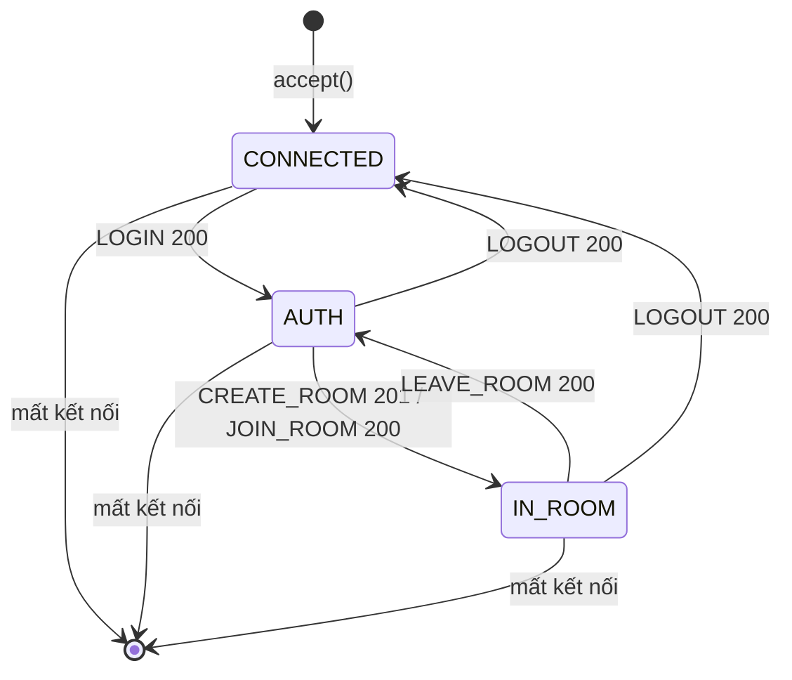
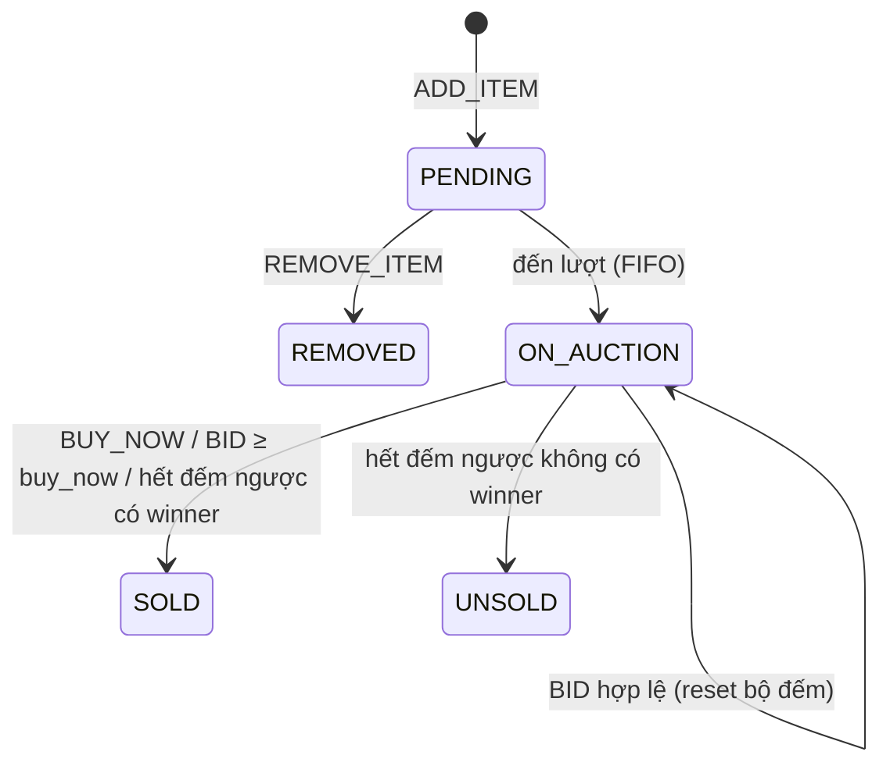

# 01 — Functional Specification (`REQ-*`)

> **Trạng thái:** Nguồn chuẩn, chuẩn bị triển khai
> **Phụ thuộc:** [`brief/00`](../brief/00-project-brief.md), [`brief/01`](../brief/01-architecture-decisions.md)
> Cú pháp lệnh và chuỗi phản hồi chính xác: [`02-protocol-spec.md`](02-protocol-spec.md).

---

## 1. Truyền dòng — tiêu chí #1

- **`REQ-STREAM-001`** Mỗi thông điệp là một dòng kết thúc `\r\n` (server chấp nhận cả `\n`, bỏ `\r` cuối — ADR-02). Server luôn gửi `\r\n`.
- **`REQ-STREAM-002`** Nhận thiếu: phần dòng chưa đủ được giữ trong bộ đệm của phiên cho tới khi có ký tự kết thúc. Nhận dính: một lần `recv()` chứa nhiều dòng → xử lý **tất cả** theo đúng thứ tự.
- **`REQ-STREAM-003`** Dòng request dài hơn `MAX_LINE` (kể cả ký tự kết thúc) → phản hồi `400 Line too long` rồi đóng kết nối sau khi gửi xong.
- **`REQ-STREAM-004`** Gửi một phần: phần chưa gửi được giữ trong hàng đợi gửi, tiếp tục khi `select()` báo ghi được. Hàng đợi vượt `SEND_BUF_SIZE` (client không đọc) → đóng kết nối, log `WARN`.

## 2. Vào/ra socket trên server — tiêu chí #2

- **`REQ-IO-001`** `./bin/server <port>`: `socket` → `setsockopt(SO_REUSEADDR)` → `bind(INADDR_ANY:port)` → `listen(BACKLOG)`. Thiếu/sai tham số → in cách dùng ra `stderr`, thoát mã 1.
- **`REQ-IO-002`** Một vòng lặp `select()` duy nhất theo dõi: listen fd (đọc), mọi client fd (đọc), client fd có hàng đợi gửi khác rỗng (ghi).
- **`REQ-IO-003`** Client fd đặt `O_NONBLOCK` ngay sau `accept()`. `EINTR` → thử lại; `EAGAIN/EWOULDBLOCK` → chờ vòng sau; lỗi khác → đóng phiên.
- **`REQ-IO-004`** Timeout `select()` = `deadline` nhỏ nhất của các phòng − now (tối thiểu 0); không có deadline → chờ vô hạn (`NULL`).
- **`REQ-IO-005`** Hết slot phiên (`MAX_CLIENTS`) → gửi `503 Server busy\r\n` (một lần `send`, bỏ qua kết quả), `close()`, log `WARN`.
- **`REQ-IO-006`** `signal(SIGPIPE, SIG_IGN)` lúc khởi động. Mọi đóng kết nối đi qua `session_close()` (spec 03 §5).

## 3. Tài khoản — tiêu chí #3

- **`REQ-ACC-001`** `REGISTER <username> <password>` khi chưa đăng nhập. `username`: 3..32 ký tự `[A-Za-z0-9_]`; `password`: 4..64 ký tự in được, không khoảng trắng, không `"`. Sai → `400`.
- **`REQ-ACC-002`** Username đã tồn tại (so sánh phân biệt hoa thường) → `409`. Đạt `MAX_ACCOUNTS` → `500`.
- **`REQ-ACC-003`** Lưu `username salt hash` vào `data/accounts.txt` ngay sau khi tạo (ADR-05, ADR-06). Không bao giờ lưu/log mật khẩu rõ.
- **`REQ-ACC-004`** Đăng ký **không** tự đăng nhập.

## 4. Đăng nhập & phiên — tiêu chí #4

- **`REQ-SES-001`** Trạng thái phiên: `CONNECTED` → (`LOGIN` OK) → `AUTH` → (`CREATE_ROOM`/`JOIN_ROOM`) → `IN_ROOM` → (`LEAVE_ROOM`) → `AUTH`; `LOGOUT` từ `AUTH`/`IN_ROOM` → `CONNECTED`; mất kết nối từ mọi trạng thái → đóng.
- **`REQ-SES-002`** `LOGIN` sai username hoặc mật khẩu → `401` (cùng một thông điệp, không lộ username nào tồn tại).
- **`REQ-SES-003`** Tài khoản đang đăng nhập ở kết nối khác → `409`. Phiên hiện tại đã đăng nhập mà gửi `LOGIN`/`REGISTER` → `409`.
- **`REQ-SES-004`** `LOGOUT`: nếu đang trong phòng thì rời phòng (broadcast `USER_LEFT`), xoá username, về `CONNECTED`, phản hồi `200`. Kết nối vẫn mở.
- **`REQ-SES-005`** Mất kết nối (`recv` = 0 hoặc lỗi): rời phòng + broadcast `USER_LEFT`, huỷ phiên, `close(fd)`, log `DISCONNECT`. Giá đã đặt vẫn giữ hiệu lực.

## 5. Kiểm soát quyền — tiêu chí #5

- **`REQ-ACL-001`** Kiểm tra theo đúng thứ tự ADR-09; mã lỗi đầu tiên gặp được trả về.
- **`REQ-ACL-002`** Ma trận quyền (✓ = cho phép; ô khác ghi mã lỗi):

  | Lệnh | CONNECTED | AUTH (ngoài phòng) | IN_ROOM — owner | IN_ROOM — member |
  |---|:-:|:-:|:-:|:-:|
  | `REGISTER`, `LOGIN` | ✓ | 409 | 409 | 409 |
  | `LOGOUT` | 401 | ✓ | ✓ | ✓ |
  | `CREATE_ROOM` | 401 | ✓ | 409 | 409 |
  | `LIST_ROOMS` | 401 | ✓ | ✓ | ✓ |
  | `JOIN_ROOM` | 401 | ✓ | 409 | 409 |
  | `LEAVE_ROOM`, `LIST_ITEMS` | 401 | 403 | ✓ | ✓ |
  | `ADD_ITEM`, `REMOVE_ITEM` | 401 | 403 | ✓ | 403 |
  | `BID`, `BUY_NOW` | 401 | 403 | 403 | ✓ |

- **`REQ-ACL-003`** `item_id` không tồn tại **hoặc** thuộc phòng khác → `404` (không lộ vật phẩm phòng khác).

## 6. Phòng — tiêu chí #6, #7, #10

- **`REQ-ROOM-001` (#6)** `CREATE_ROOM "<name>"`: tên 1..64 ký tự, không `"`, không ký tự điều khiển. Cấp `room_id` tăng dần từ 1. Người tạo thành owner và **tự vào phòng** (`IN_ROOM`). Lưu `data/rooms.txt`. Đạt `MAX_ROOMS` → `500`.
- **`REQ-ROOM-002` (#7)** `LIST_ROOMS`: mọi phòng, theo `room_id` tăng dần, mỗi phòng gồm id, owner, tên, số người đang ở trong phòng (cả owner nếu đang trong), id vật phẩm `ON_AUCTION` (`-` nếu không có), số vật phẩm `PENDING`.
- **`REQ-ROOM-003` (#10)** `JOIN_ROOM <room_id>`: phòng không tồn tại → `404`; đang ở phòng (kể cả phòng đó) → `409`. Thành công: phản hồi, broadcast `USER_JOINED` cho **người khác** trong phòng, rồi gửi riêng cho người vào: `AUCTION_START` của vật phẩm đang đấu giá (nếu có) và `NEW_BID` với giá hiện tại (nếu đã có người đặt).
- **`REQ-ROOM-004` (#10)** Mỗi người chỉ ở **một** phòng; owner rời phòng vẫn là owner, phòng và phiên đấu giá vẫn chạy; owner vào lại phòng mình bằng `JOIN_ROOM`.
- **`REQ-ROOM-005` (#10)** `LEAVE_ROOM`: phản hồi rồi broadcast `USER_LEFT` cho người còn lại; phiên về `AUTH`.

## 7. Vật phẩm — tiêu chí #8, #9

- **`REQ-ITEM-001` (#8)** `ADD_ITEM "<name>" "<desc>" <start_price> <buy_now_price>` chỉ owner đang trong phòng. Tên 1..64, mô tả 0..256 ký tự (không `"`, không ký tự điều khiển). Giá: số nguyên thập phân, chỉ chữ số, `1 ≤ giá ≤ MAX_PRICE`; sai định dạng → `400`.
- **`REQ-ITEM-002` (#8)** `buy_now_price <= start_price` → `422`. Phòng đã có `MAX_PENDING_PER_ROOM` vật phẩm `PENDING` hoặc toàn hệ thống đạt `MAX_ITEMS` → `409`.
- **`REQ-ITEM-003` (#8)** Vật phẩm mới: `item_id` tăng dần toàn hệ thống, `status = PENDING`, `current_price = start_price`, `winner` rỗng. Hàng đợi FIFO theo `item_id` tăng dần. Lưu `data/items.txt`. Phản hồi `201`, broadcast `ITEM_ADDED` cho cả phòng.
- **`REQ-ITEM-004` (#8)** Nếu phòng chưa có vật phẩm `ON_AUCTION` → vật phẩm `PENDING` đầu hàng đợi lên sàn ngay (spec 03 §6 `auction_start_next`), broadcast `AUCTION_START`.
- **`REQ-ITEM-005` (#9)** `REMOVE_ITEM <item_id>`: chỉ owner; không thuộc phòng → `404`; không ở `PENDING` → `409`. Thành công: `status = REMOVED`, lưu file, phản hồi, broadcast `ITEM_REMOVED`.
- `LIST_ITEMS` (hỗ trợ #8, #10): vật phẩm `ON_AUCTION` trước, rồi các `PENDING` theo FIFO.

## 8. Tố giá — tiêu chí #11

- **`REQ-AUC-001`** `BID <item_id> <price>`: chỉ member. Không thuộc phòng → `404`; không `ON_AUCTION` → `409`.
- **`REQ-AUC-002`** Hợp lệ khi `price >= current_price + BID_STEP` (`current_price = start_price` khi chưa ai đặt). Thấp hơn → `422 Bid must be at least <min>`.
- **`REQ-AUC-003`** `price >= buy_now_price` → xử lý **y hệt `BUY_NOW`** ở giá `buy_now_price` (REQ-BUY-002).
- **`REQ-AUC-004`** BID hợp lệ: `current_price = price`, `winner = username`, lưu file, `countdown_stage = 0`, `deadline = now + AUCTION_IDLE_SEC`, phản hồi `200`, broadcast `NEW_BID` cho cả phòng (kể cả người đặt).
- **`REQ-AUC-005`** Bộ đếm theo ADR-03: `COUNTDOWN <item_id> <1|2|3> <current_price>` broadcast cho phòng; sau lần 3 + `COUNTDOWN_INTERVAL_SEC`: có `winner` → `SOLD`; không → `UNSOLD`. Lưu file, rồi `auction_start_next`.
- **`REQ-AUC-006`** Người đặt giá đã rời phòng/mất kết nối vẫn có thể thắng (`SOLD` mang username đó).

## 9. Mua ngay — tiêu chí #12

- **`REQ-BUY-001`** `BUY_NOW <item_id>`: chỉ member; không thuộc phòng → `404`; không `ON_AUCTION` → `409`.
- **`REQ-BUY-002`** Thành công: `current_price = buy_now_price`, `winner = username`, `status = SOLD`, lưu file, phản hồi `200`, broadcast `SOLD`, `auction_start_next`.
- **`REQ-BUY-003`** Hai `BUY_NOW` gần như đồng thời: người đến trước thắng, người sau nhận `409` (vật phẩm đã `SOLD`) hoặc thao tác trên vật phẩm kế tiếp nếu id khác.

## 10. Ghi log — tiêu chí #13

- **`REQ-LOG-001`** Ghi `logs/server.log` (append, `fflush` sau mỗi dòng) theo định dạng spec 04 §3.
- **`REQ-LOG-002`** Bắt buộc log: `START`/`STOP` server, `CONNECT`, `DISCONNECT`, mọi lệnh (`OK` hoặc `REJECT(code)`), `COUNTDOWN`, `SOLD`, `UNSOLD`, `AUCTION_START`, lỗi I/O, lỗi lưu file, `503`, dòng quá dài.
- **`REQ-LOG-003`** Không log mật khẩu; với `REGISTER`/`LOGIN` chỉ log username.

---

## 11. Sơ đồ trạng thái

### 11.1 Phiên

### 11.2 Vật phẩm

