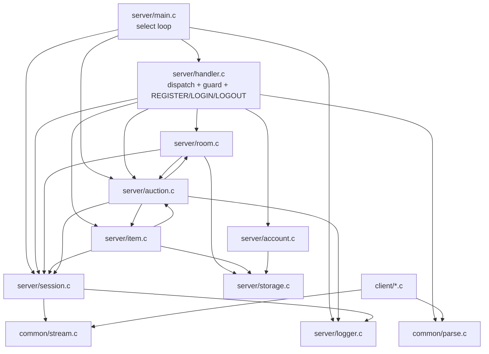

# 03 — Server Design Specification (module, struct, chữ ký hàm)

> **Trạng thái:** Nguồn chuẩn cho Chặng 0 (đóng băng header — ADR-07).
> Agent chỉ cài đặt **thân hàm** trong file `.c` được giao; đổi chữ ký/struct → dừng, báo người điều phối.

---

## 1. Sơ đồ phụ thuộc



Header `common/protocol.h` được mọi file include. Module **không** đọc biến toàn cục của module khác; chỉ gọi hàm public.

---

## 2. `common/protocol.h` (hằng số)

Mọi hằng số có `#ifndef X / #define X ... / #endif` để ghi đè bằng `-D`.

| Hằng số | Giá trị | Ghi chú |
|---|---|---|
| `DEFAULT_PORT` | `5500` | |
| `BACKLOG` | `16` | `listen()` |
| `MAX_LINE` | `4096` | request, kể cả `\r\n` |
| `MAX_RESP_LINE` | `16384` | |
| `RECV_BUF_SIZE` | `MAX_RESP_LINE` | dùng chung server/client |
| `SEND_BUF_SIZE` | `65536` | |
| `MAX_CLIENTS` | `(FD_SETSIZE - 8)` | trừ stdin/out/err, listen fd, file log… |
| `MAX_TOKENS` | `8` | |
| `MIN_USERNAME` / `MAX_USERNAME` | `3` / `32` | |
| `MIN_PASSWORD` / `MAX_PASSWORD` | `4` / `64` | |
| `MAX_ROOM_NAME` | `64` | |
| `MAX_ITEM_NAME` / `MAX_ITEM_DESC` | `64` / `256` | |
| `MAX_ACCOUNTS` | `1024` | |
| `MAX_ROOMS` | `64` | |
| `MAX_ITEMS` | `2048` | tổng mọi trạng thái |
| `MAX_PENDING_PER_ROOM` | `32` | |
| `MAX_PRICE` | `1000000000000LL` | |
| `BID_STEP` | `10000` | |
| `AUCTION_IDLE_SEC` | `180` | |
| `COUNTDOWN_INTERVAL_SEC` | `10` | |
| `COUNTDOWN_TIMES` | `3` | |
| `SALT_LEN` | `16` | ký tự hex |
| `HASH_ROUNDS` | `1000` | |
| `DATA_DIR`, `LOG_FILE` | `"data"`, `"logs/server.log"` | |
| `ACCOUNTS_FILE`, `ROOMS_FILE`, `ITEMS_FILE` | `"data/accounts.txt"`… | |

Mã phản hồi: `enum { RC_OK = 200, RC_CREATED = 201, RC_BAD_REQUEST = 400, RC_UNAUTHORIZED = 401, RC_FORBIDDEN = 403, RC_NOT_FOUND = 404, RC_CONFLICT = 409, RC_INVALID_PRICE = 422, RC_INTERNAL = 500, RC_BUSY = 503 };`

Tên lệnh/sự kiện: `#define CMD_REGISTER "REGISTER"` …, `#define EVT_NEW_BID "NEW_BID"` … (đủ bảng spec 02 §3, §6).

---

## 3. `common/` — dùng chung server & client

### 3.1 `common/stream.h`
```c
typedef struct { char buf[RECV_BUF_SIZE]; size_t len; } recv_buffer_t;
typedef struct { char buf[SEND_BUF_SIZE]; size_t len; size_t off; } send_buffer_t;

void    stream_recv_init(recv_buffer_t *rb);
/* Nối n byte vào cuối bộ đệm. 0 = OK, -1 = không đủ chỗ. */
int     stream_recv_append(recv_buffer_t *rb, const char *data, size_t n);
/* Lấy một dòng (bỏ \n và \r cuối) vào out. 1 = có dòng, 0 = chưa đủ,
   -1 = dòng dài hơn max_line (gồm kết thúc dòng) hoặc không vừa out. */
int     stream_next_line(recv_buffer_t *rb, char *out, size_t cap, size_t max_line);

void    stream_send_init(send_buffer_t *sb);
int     stream_send_append(send_buffer_t *sb, const char *data, size_t n); /* -1 = đầy */
int     stream_send_pending(const send_buffer_t *sb);                      /* 1 nếu còn dữ liệu */
/* Gửi phần còn lại bằng send(); xử lý EINTR; EAGAIN → trả 0.
   Trả số byte đã gửi (≥0) hoặc -1 nếu lỗi thật. Dồn bộ đệm khi off > len/2. */
ssize_t stream_flush(int fd, send_buffer_t *sb);
/* Client (socket chặn): gửi hết n byte, lặp khi gửi thiếu/EINTR. 0 = OK, -1 = lỗi. */
int     stream_send_all(int fd, const char *data, size_t n);
```

### 3.2 `common/parse.h`
```c
/* Tách token theo spec 02 §2. line bị sửa tại chỗ (chèn '\0').
   Trả số token (≥0), hoặc -1 sai cú pháp (ngoặc kép), -2 quá MAX_TOKENS. */
int  parse_tokenize(char *line, char *tokens[], int max_tokens);
/* Chuỗi chỉ gồm chữ số, giá trị trong [min, max]. 0 = OK, -1 = sai. */
int  parse_ll(const char *s, long long min, long long max, long long *out);
int  parse_valid_username(const char *s);              /* 1 = hợp lệ */
int  parse_valid_password(const char *s);
/* Chuỗi in được, không '"', không byte < 0x20, độ dài trong [min_len, max_len]. */
int  parse_valid_text(const char *s, size_t min_len, size_t max_len);
/* Tách danh sách "; " bên ngoài ngoặc kép (client dùng). Trả số đoạn. */
int  parse_split_records(char *line, char *records[], int max_records);
```

---

## 4. `server/` — module

### 4.1 `server/session.h` — sở hữu: Chặng 1A
```c
typedef enum { SS_CONNECTED = 0, SS_AUTH, SS_IN_ROOM } session_state_t;

typedef struct session {
    int             in_use;
    int             fd;
    char            addr[32];                 /* "ip:port" */
    session_state_t state;
    char            username[MAX_USERNAME + 1];
    int             room_id;                  /* 0 = không ở phòng */
    int             closing;                  /* 1 = đóng sau khi gửi hết */
    int             replied;                  /* ADR-04 */
    char            cur_cmd[32];              /* tên lệnh đang xử lý */
    char            cur_log[160];             /* tham số đã lọc để log */
    recv_buffer_t   rbuf;
    send_buffer_t   sbuf;
} session_t;

void        session_init_all(void);
session_t  *session_create(int fd, const char *addr);   /* NULL nếu hết slot */
session_t  *session_at(int index);                      /* NULL nếu slot trống */
int         session_capacity(void);                     /* = MAX_CLIENTS */
session_t  *session_find_by_user(const char *username);
/* Định dạng printf, tự thêm "\r\n", xếp hàng gửi. Đầy → đặt closing=1, log WARN. */
void        session_send(session_t *s, const char *fmt, ...);
/* Gửi cho mọi phiên có room_id, trừ exclude (có thể NULL). */
void        session_broadcast_room(int room_id, const session_t *exclude, const char *fmt, ...);
const char *session_subject(const session_t *s);        /* username nếu đã login, ngược lại addr */
/* Đường đóng DUY NHẤT: room_leave (nếu trong phòng) → log DISCONNECT reason → close(fd) → xoá slot. */
void        session_close(session_t *s, const char *reason);
```

### 4.2 `server/handler.h` — sở hữu: Chặng 2A
```c
enum {
    G_NONE = 0, G_NOT_AUTH = 1 << 0, G_AUTH = 1 << 1,
    G_IN_ROOM = 1 << 2, G_NOT_IN_ROOM = 1 << 3,
    G_OWNER = 1 << 4, G_NOT_OWNER = 1 << 5
};
typedef int (*cmd_fn)(session_t *s, int argc, char *argv[]);   /* argv[0] = tham số đầu tiên */
typedef struct { const char *name; int argc; int guards; cmd_fn fn; } command_t;

/* Xử lý một dòng: tokenize → tra bảng → guard (ADR-09 bước 1–5) → gọi fn → kiểm replied. */
void handler_process_line(session_t *s, char *line);
/* Gửi đúng một phản hồi "<code> <msg>" + log OK/REJECT(code). Đặt s->replied = 1. */
void cmd_reply(session_t *s, int code, const char *fmt, ...);

int cmd_register(session_t *s, int argc, char *argv[]);
int cmd_login(session_t *s, int argc, char *argv[]);
int cmd_logout(session_t *s, int argc, char *argv[]);
```
Bảng `command_t` (chép nguyên spec 02 §3) nằm trong `handler.c`, viết sẵn ở Chặng 0.
`cur_log` của `REGISTER`/`LOGIN` chỉ chứa username (REQ-LOG-003); lệnh khác chứa các tham số nối bằng dấu cách, cắt ở 159 ký tự.

### 4.3 `server/account.h` — sở hữu: Chặng 1B
```c
typedef struct { char username[MAX_USERNAME + 1]; char salt[SALT_LEN + 1]; char hash[17]; } account_t;

int  account_load(void);                     /* đọc ACCOUNTS_FILE; thiếu file = rỗng; 0/-1 */
/* 0 = OK, ACC_ERR_EXISTS, ACC_ERR_FULL, ACC_ERR_IO */
int  account_register(const char *username, const char *password);
int  account_verify(const char *username, const char *password);   /* 1 = đúng */
void account_hash(const char *salt, const char *password, char out_hex[17]);  /* FNV-1a 64 × HASH_ROUNDS */
enum { ACC_OK = 0, ACC_ERR_EXISTS = -1, ACC_ERR_FULL = -2, ACC_ERR_IO = -3 };
```

### 4.4 `server/room.h` — sở hữu: Chặng 2A
```c
typedef struct {
    int    in_use;
    int    id;
    char   owner[MAX_USERNAME + 1];
    char   name[MAX_ROOM_NAME + 1];
    int    current_item_id;      /* 0 = không có ON_AUCTION */
    time_t deadline;             /* 0 = bộ đếm không chạy */
    int    countdown_stage;      /* 0..COUNTDOWN_TIMES */
} room_t;

int     room_load(void);
int     room_save(void);
room_t *room_find(int room_id);
room_t *room_at(int index);              /* duyệt; NULL nếu slot trống */
int     room_capacity(void);             /* = MAX_ROOMS */
int     room_member_count(int room_id);
/* Rời phòng: set room_id=0, state=SS_AUTH, broadcast USER_LEFT cho người còn lại. Không reply. */
void    room_leave(session_t *s);

int cmd_create_room(session_t *s, int argc, char *argv[]);
int cmd_list_rooms (session_t *s, int argc, char *argv[]);
int cmd_join_room  (session_t *s, int argc, char *argv[]);
int cmd_leave_room (session_t *s, int argc, char *argv[]);
```

### 4.5 `server/item.h` — sở hữu: Chặng 2B
```c
typedef enum { IS_PENDING = 0, IS_ON_AUCTION, IS_SOLD, IS_UNSOLD, IS_REMOVED } item_status_t;

typedef struct {
    int           in_use;
    int           id;
    int           room_id;
    item_status_t status;
    long long     start_price, buy_now_price, current_price;
    char          winner[MAX_USERNAME + 1];   /* "" = chưa ai đặt */
    char          name[MAX_ITEM_NAME + 1];
    char          desc[MAX_ITEM_DESC + 1];
} item_t;

int         item_load(void);
int         item_save(void);
item_t     *item_find(int item_id);
item_t     *item_find_in_room(int item_id, int room_id);   /* NULL nếu không thuộc phòng */
item_t     *item_next_pending(int room_id);                /* id nhỏ nhất ở PENDING */
int         item_pending_count(int room_id);
const char *item_status_name(item_status_t st);            /* "PENDING", ... */
int         item_status_parse(const char *s, item_status_t *out);

int cmd_add_item   (session_t *s, int argc, char *argv[]);
int cmd_remove_item(session_t *s, int argc, char *argv[]);
int cmd_list_items (session_t *s, int argc, char *argv[]);
```

### 4.6 `server/auction.h` — sở hữu: Chặng 2B
```c
/* Đưa PENDING kế tiếp lên sàn: status=ON_AUCTION, room.current_item_id, stage=0,
   deadline=now+AUCTION_IDLE_SEC, lưu file, broadcast AUCTION_START, log.
   Không còn PENDING → current_item_id=0, deadline=0. */
void auction_start_next(room_t *r, time_t now);
/* Kết thúc vật phẩm đang đấu giá (SOLD nếu có winner, ngược lại UNSOLD), broadcast, lưu, start_next. */
void auction_finish(room_t *r, time_t now);
/* Xử lý mọi phòng có deadline <= now (ADR-03). Gọi sau mỗi lần select() trả về. */
void auction_tick(time_t now);
/* Số giây tới deadline gần nhất (≥0), hoặc -1 nếu không phòng nào chạy bộ đếm. */
long auction_next_timeout(time_t now);
/* Gửi riêng cho s trạng thái hiện tại của phòng (AUCTION_START + NEW_BID nếu có). Dùng sau JOIN_ROOM. */
void auction_send_state(session_t *s, const room_t *r);
/* Khởi động lại bộ đếm sau khi nạp file (ADR-10). */
void auction_resume_all(time_t now);

int cmd_bid    (session_t *s, int argc, char *argv[]);
int cmd_buy_now(session_t *s, int argc, char *argv[]);
```

### 4.7 `server/storage.h` — sở hữu: Chặng 1B
```c
/* Gọi cb cho từng dòng (đã bỏ \r\n, bỏ dòng rỗng). File không tồn tại → 0 (rỗng).
   cb trả -1 → dừng, hàm trả -1. */
typedef int (*storage_line_cb)(char *line, void *ctx);
int storage_read_lines(const char *path, storage_line_cb cb, void *ctx);
/* Mở "<path>.tmp", gọi writer(fp, ctx), fflush, fclose, rename → path. Lỗi → remove tmp, trả -1. */
typedef int (*storage_writer)(FILE *fp, void *ctx);
int storage_write_file(const char *path, storage_writer writer, void *ctx);
```

### 4.8 `server/logger.h` — sở hữu: Chặng 1B
```c
typedef enum { LOG_INFO = 0, LOG_WARN, LOG_ERROR } log_level_t;
int  logger_init(const char *path);      /* fopen "a"; lỗi → in stderr, trả -1 (server vẫn chạy, log ra stderr) */
void logger_log(log_level_t lv, const char *subject, const char *fmt, ...);
void logger_close(void);
```

---

## 5. Vòng lặp chính `server/main.c` — sở hữu: Chặng 1A

```text
main(argc, argv):
    port = parse_ll(argv[1], 1, 65535)        sai → usage, exit 1
    access(DATA_DIR) / access("logs") thất bại → "run: mkdir -p data logs", exit 1
    srand(time(NULL) ^ getpid()); signal(SIGPIPE, SIG_IGN)
    logger_init(LOG_FILE); session_init_all()
    account_load(); room_load(); item_load(); auction_resume_all(time(NULL))
    listenfd = socket → setsockopt(SO_REUSEADDR) → bind → listen     lỗi → perror, exit 1
    log START port
    loop:
        FD_ZERO(r), FD_ZERO(w); FD_SET(listenfd, r); maxfd = listenfd
        for s in sessions: FD_SET(s.fd, r); if stream_send_pending(s.sbuf): FD_SET(s.fd, w)
        t = auction_next_timeout(time(NULL)); tvp = (t < 0) ? NULL : &{t, 0}
        n = select(maxfd+1, &r, &w, NULL, tvp)
        n < 0 && errno == EINTR → continue;   n < 0 → log ERROR, continue
        if FD_ISSET(listenfd, r): accept_one()           (một accept mỗi vòng là đủ)
        for s in sessions (duyệt theo chỉ số, kiểm tra in_use mỗi lần):
            if FD_ISSET(s.fd, r): on_readable(s)
            if s còn in_use && FD_ISSET(s.fd, w): on_writable(s)
            if s còn in_use && s.closing && !stream_send_pending(s.sbuf): session_close(s, "closing")
        auction_tick(time(NULL))
```

- `accept_one()`: `accept` → `inet_ntoa/ntohs` tạo `addr` → `fcntl O_NONBLOCK` → `session_create`; `NULL` → `503` + `close` + log WARN; OK → log `CONNECT`.
- `on_readable(s)`: lặp `recv(fd, tmp, sizeof tmp, 0)`: `>0` → `stream_recv_append` (đầy → coi như dòng quá dài); `0` → `session_close(s, "peer closed")`, return; `-1`: `EINTR` thử lại, `EAGAIN` thoát lặp, khác → `session_close(s, strerror(errno))`, return. Sau đó lặp `stream_next_line(..., MAX_LINE)`: `1` → nếu dòng không rỗng `handler_process_line`; dừng nếu phiên đã đóng hoặc `closing`; `-1` → `session_send(s, "400 Line too long")`, log WARN, `closing = 1`.
- `on_writable(s)`: `stream_flush` trả `-1` → `session_close(s, "send error")`.
- Chú ý: handler có thể đóng/huỷ **phiên khác** gián tiếp? **Không** — chỉ `main.c` và `session_close` của chính phiên được gọi; broadcast chỉ xếp hàng gửi.

## 6. Thuật toán nghiệp vụ chính

### 6.1 `auction_tick(now)`
```text
for r in rooms (in_use, deadline != 0, deadline <= now):
    if r.countdown_stage < COUNTDOWN_TIMES:
        r.countdown_stage++
        broadcast "NOTIFY COUNTDOWN <item> <stage> <current_price>"; log
        r.deadline = now + COUNTDOWN_INTERVAL_SEC
    else:
        auction_finish(r, now)
```

### 6.2 `cmd_bid`
```text
item = item_find_in_room(id, s.room_id)        NULL → 404 Item not found
item.status != ON_AUCTION                       → 409 Item is not on auction
min = item.current_price + BID_STEP
price < min                                     → 422 Bid must be at least <min>
price >= item.buy_now_price                     → do_buy_now(s, item)  (giống BUY_NOW)
item.current_price = price; winner = s.username; item_save()
r.countdown_stage = 0; r.deadline = now + AUCTION_IDLE_SEC
cmd_reply(200 Bid accepted); broadcast NEW_BID (cả phòng)
```

### 6.3 `do_buy_now` (static trong `auction.c`, dùng cho BUY_NOW và BID ≥ buy_now)
```text
item.current_price = item.buy_now_price; winner = s.username; status = SOLD; item_save()
cmd_reply(200 Bought item <id> price <buy_now>); broadcast SOLD; log
r.current_item_id = 0; r.deadline = 0; auction_start_next(r, now)
```

### 6.4 `cmd_add_item`
```text
validate name/desc/giá (400) → buy_now <= start (422) → pending đầy / MAX_ITEMS (409)
tạo item PENDING, item_save() lỗi → 500
cmd_reply(201 Item added <id>); broadcast ITEM_ADDED (cả phòng)
if r.current_item_id == 0: auction_start_next(r, now)
```

## 7. Quy tắc code bắt buộc trong module

- Mảng tĩnh `static` trong từng `.c`; không `malloc` cho dữ liệu nghiệp vụ.
- Mọi copy chuỗi: `snprintf(dst, sizeof dst, "%s", src)` hoặc `strncpy` + gán `'\0'`.
- Mỗi hàm lệnh gọi `cmd_reply` đúng một lần ở **mọi** nhánh trả về.
- Lưu file thất bại sau khi đã đổi bộ nhớ: vẫn giữ trạng thái bộ nhớ, log `ERROR`, phản hồi như thành công (dữ liệu sẽ ghi lại ở lần lưu kế tiếp). Ngoại lệ: `REGISTER` lỗi lưu → hoàn tác, `500`.
